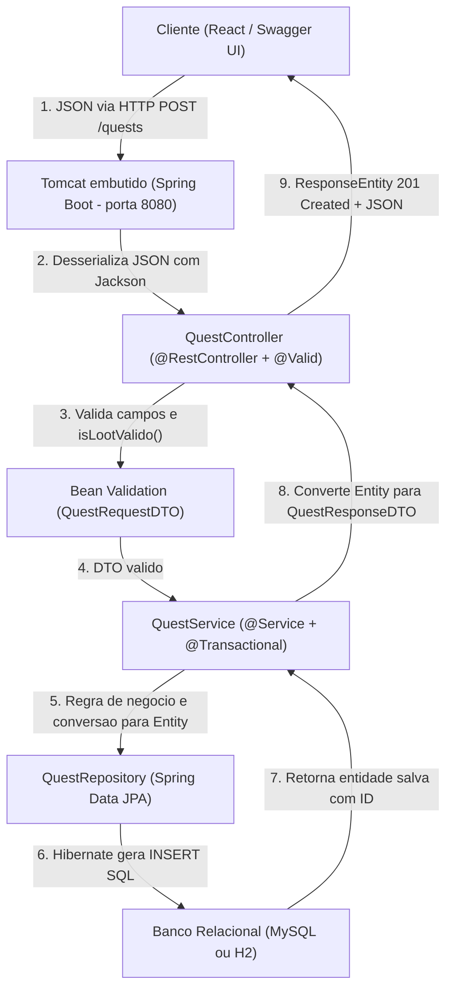

# Guia Técnico de Estudo e Entrevista — `quest-api`

> [!NOTE]
> Este guia consolida **onde cada tecnologia está aplicada no código** da `quest-api`, **de qual pacote/camada cada anotação realmente vem**, e **como explicar tudo com clareza em entrevistas técnicas**.

---

## 1. Visão Geral do Ecossistema (Quem é quem no código)

Muita dúvida surge porque, ao escrever uma classe Spring, você mistura anotações de várias especificações e módulos no mesmo arquivo. A tabela abaixo separa **quem fornece o quê**:

| Tecnologia / Módulo | Pacote / Origem no código | Papel real na aplicação | Exemplos no seu projeto |
| :--- | :--- | :--- | :--- |
| **Spring Boot** | `org.springframework.boot.*` + `pom.xml` | Orquestrador e autoconfiguração (sobe Tomcat, lê `application*.properties`, ativa *starters*) | `@SpringBootApplication`, perfis `mysql`/`h2`, starters no [pom.xml](file:///c:/Users/ryand/Desktop/backtopeak/semana-05-06-projeto-estrela/quest-api/pom.xml#L6-L50) |
| **Spring Framework (Core / Context / Tx)** | `org.springframework.*` | Container de injeção de dependências (IoC) e gerenciamento de transações | `@Service`, `@Repository`, `@Configuration`, `@Transactional` |
| **Spring Web (MVC)** | `org.springframework.web.bind.annotation.*` | Camada HTTP/REST: mapeia rotas, verbos, parâmetros da URL e JSON de entrada/saída | `@RestController`, `@RequestMapping`, `@GetMapping`, `@PostMapping`, `@PatchMapping`, `@DeleteMapping`, `@PathVariable`, `@RequestBody` |
| **JPA** | `jakarta.persistence.*` | **Especificação** padrão Java (Jakarta EE) de mapeamento objeto-relacional (ORM) | `@Entity`, `@Table`, `@Id`, `@GeneratedValue`, `@Column` |
| **Hibernate** | Incluído no `spring-boot-starter-data-jpa` | **Implementação** da JPA que realmente gera e executa os comandos SQL no MySQL/H2 | Atua por baixo dos panos via `ddl-auto=update` e `show-sql=true` |
| **Spring Data JPA** | `org.springframework.data.jpa.*` | Módulo Spring acima da JPA/Hibernate que elimina DAOs repetitivos | `JpaRepository<Quest, Long>`, `existsByTitulo`, `existsByNome` |
| **Bean Validation** | `jakarta.validation.*` | **Especificação** de validação declarativa de campos de entrada (implementada pelo *Hibernate Validator*) | `@Valid`, `@NotBlank`, `@Size`, `@NotNull`, `@Min`, `@AssertTrue` |
| **Jackson** | Incluído no `spring-boot-starter-web` | Serializa objetos/DTOs Java para JSON e desserializa JSON em DTOs; `@JsonIgnore` oculta métodos/campos | `@JsonIgnore` em [QuestRequestDTO.java](file:///c:/Users/ryand/Desktop/backtopeak/semana-05-06-projeto-estrela/quest-api/src/main/java/com/quest_api/dto/QuestRequestDTO.java#L19) |
| **OpenAPI + Swagger UI** | `org.springdoc:springdoc-openapi-starter-webmvc-ui` | Gera o contrato JSON padrão **OpenAPI** (`/v3/api-docs`) e a interface visual **Swagger UI** (`/swagger-ui.html`) | Configurado no [pom.xml](file:///c:/Users/ryand/Desktop/backtopeak/semana-05-06-projeto-estrela/quest-api/pom.xml#L45-L49) e [application.properties](file:///c:/Users/ryand/Desktop/backtopeak/semana-05-06-projeto-estrela/quest-api/src/main/resources/application.properties#L12) |

---

## 2. Fluxo Completo de uma Requisição (`POST /quests`)

---

## 3. Detalhamento por Tecnologia (Onde está + Como funciona + Cola de Entrevista)

### 1. Spring Boot

* **O que realmente faz no projeto:** Ele configura automaticamente toda a infraestrutura com base nas dependências do projeto e nos arquivos de propriedades. As anotações de negócio e rotas vêm dos módulos do Spring Framework (Spring Web, Spring Core, Spring Data), enquanto o Spring Boot garante que tudo suba conectado com uma única linha (`SpringApplication.run`).
* **Onde está no código:**
  * [pom.xml](file:///c:/Users/ryand/Desktop/backtopeak/semana-05-06-projeto-estrela/quest-api/pom.xml#L6-L33): herda `spring-boot-starter-parent` (`3.4.3`) e importa os *starters* (`spring-boot-starter-web`, `spring-boot-starter-data-jpa`, `spring-boot-starter-validation`).
  * [QuestApiApplication.java](file:///c:/Users/ryand/Desktop/backtopeak/semana-05-06-projeto-estrela/quest-api/src/main/java/com/quest_api/QuestApiApplication.java#L6-L11): `@SpringBootApplication` liga a autoconfiguração, o servidor **Tomcat** embutido e o escaneamento de classes (`@RestController`, `@Service`, `@Repository`, `@Configuration`), viabilizando a injeção de dependências via construtor.
  * [application.properties](file:///c:/Users/ryand/Desktop/backtopeak/semana-05-06-projeto-estrela/quest-api/src/main/resources/application.properties#L1-L12), [application-mysql.properties](file:///c:/Users/ryand/Desktop/backtopeak/semana-05-06-projeto-estrela/quest-api/src/main/resources/application-mysql.properties#L1-L4) e [application-h2.properties](file:///c:/Users/ryand/Desktop/backtopeak/semana-05-06-projeto-estrela/quest-api/src/main/resources/application-h2.properties#L1-L6): definem porta, comportamento do Hibernate/JPA e troca de ambiente via **Profiles** (`mysql` ou `h2`).
  * [CorsConfig.java](file:///c:/Users/ryand/Desktop/backtopeak/semana-05-06-projeto-estrela/quest-api/src/main/java/com/quest_api/config/CorsConfig.java#L7-L16): `@Configuration` implementando `WebMvcConfigurer` para liberar chamadas do frontend React em `http://localhost:5173`.
* **Como responder na entrevista:**
  > *"Usei o Spring Boot 3.4 para estruturar a API com servidor Tomcat embutido, autoconfiguração, perfis de banco separados para MySQL e H2 em memória e injeção de dependências via construtor entre Controller, Service e Repository."*

---

### 2. Spring Data JPA (vs. JPA e Hibernate)

* **Esclarecimento importante:** As anotações do Controller (`@RestController`, `@GetMapping`, etc.) **não** são do Spring Data JPA — elas pertencem ao **Spring Web (MVC)**. Para o banco de dados, existem três peças distintas trabalhando em camadas:
  1. **JPA (`jakarta.persistence.*`):** é a **especificação** padrão do Java/Jakarta EE (apenas o contrato e as anotações `@Entity`, `@Table`, `@Id`, `@GeneratedValue`, `@Column`).
  2. **Hibernate:** é o **motor (implementação)** da JPA incluído no starter — quem realmente traduz suas entidades Java em comandos SQL para o MySQL ou H2.
  3. **Spring Data JPA (`org.springframework.data.jpa.*`):** é o **módulo do ecossistema Spring** que cria automaticamente as implementações das suas interfaces de repositório em tempo de execução.
* **Onde está no código:**
  * **Entidades JPA:** [Quest.java](file:///c:/Users/ryand/Desktop/backtopeak/semana-05-06-projeto-estrela/quest-api/src/main/java/com/quest_api/model/Quest.java#L5-L27) e [Heroi.java](file:///c:/Users/ryand/Desktop/backtopeak/semana-05-06-projeto-estrela/quest-api/src/main/java/com/quest_api/model/Heroi.java#L5-L23) (com construtor vazio obrigatório para o Hibernate instanciar objetos ao ler do banco).
  * **Repositórios Spring Data JPA:** [QuestRepository.java](file:///c:/Users/ryand/Desktop/backtopeak/semana-05-06-projeto-estrela/quest-api/src/main/java/com/quest_api/repository/QuestRepository.java#L8-L11) (`existsByTitulo`) e [HeroiRepository.java](file:///c:/Users/ryand/Desktop/backtopeak/semana-05-06-projeto-estrela/quest-api/src/main/java/com/quest_api/repository/HeroiRepository.java#L8-L12) (`existsByNome`) estendendo `JpaRepository<..., Long>`, herdando `save`, `findAll`, `findById` e `deleteById`.
  * **Controle transacional:** [QuestService.java](file:///c:/Users/ryand/Desktop/backtopeak/semana-05-06-projeto-estrela/quest-api/src/main/java/com/quest_api/service/QuestService.java#L28-L80) usa `@Transactional` (e `readOnly = true` em leituras) para garantir atomicidade ao concluir uma quest e atualizar XP/nível do herói juntos.
* **Como responder na entrevista:**
  > *"Mapeiei `Heroi` e `Quest` com anotações da JPA e utilizei Spring Data JPA com interfaces estendendo `JpaRepository`, aproveitando operações CRUD prontas, derived queries como `existsByTitulo` e controle transacional com `@Transactional` na camada Service."*

---

### 3. APIs RESTful

* **O que define ela como RESTful (além de ser uma API):**
  * **Recursos como substantivos nas URLs:** expõe entidades (`/herois`, `/quests/{id}`), evitando URLs focadas em verbos estilo `/criarHeroi`. *(Em `PATCH /quests/{qId}/concluir/{hId}`, o sub-recurso representa uma transição específica de estado de negócio — prática comum em APIs REST).*
  * **Uso semântico dos verbos HTTP:** `GET` lê, `POST` cria, `PATCH` faz atualização parcial de estado (`concluir`) e `DELETE` remove.
  * **Status Codes HTTP coerentes:** devolve o código exato da operação via `ResponseEntity`, em vez de devolver sempre `200 OK`.
  * **Stateless:** o servidor não guarda estado de sessão do cliente entre requisições; cada chamada HTTP carrega tudo que é necessário.
  * **Representação padronizada:** comunicação cliente-servidor em JSON.
* **Onde está no código:**
  * [QuestController.java](file:///c:/Users/ryand/Desktop/backtopeak/semana-05-06-projeto-estrela/quest-api/src/main/java/com/quest_api/controller/QuestController.java#L22-L53) (`/quests`): `POST` retornando `201 Created` (`HttpStatus.CREATED`), `GET` e `PATCH` retornando `200 OK`.
  * [HeroiController.java](file:///c:/Users/ryand/Desktop/backtopeak/semana-05-06-projeto-estrela/quest-api/src/main/java/com/quest_api/controller/HeroiController.java#L12-L42) (`/herois`): `POST` (`201 Created`), `GET` (`200 OK`) e `DELETE` retornando `204 No Content` (`ResponseEntity.noContent().build()`).
* **Como responder na entrevista:**
  > *"Estruturei os recursos `/herois` e `/quests` com `@RestController`, usando verbos HTTP semânticos — incluindo `PATCH` para a conclusão parcial da quest — e devolvendo `ResponseEntity` com status codes apropriados (`201`, `200` e `204`)."*

---

### 4. Bean Validation (e o que é um "Bean")

* **Esclarecimento importante:** As anotações de validação (`@NotBlank`, `@Size`, `@NotNull`, `@Min`, `@AssertTrue`, `@Valid`) **não** vêm do Spring Data JPA — elas pertencem à especificação **`jakarta.validation`** (executada por baixo dos panos pelo **Hibernate Validator**, que apesar do nome "Hibernate" não mexe com banco de dados: ele apenas valida objetos em memória).
* **O que é um "Bean"?**
  * **Sentido tradicional (JavaBean):** nome histórico para objetos Java simples que encapsulam dados e propriedades. Por isso **Bean Validation** significa validar atributos de objetos de entrada (inclusive Java `record` DTOs).
  * **Sentido no Spring:** dentro do ecossistema Spring, **Bean** também é o nome dado a qualquer **objeto instanciado e gerenciado pelo Spring Container** (como suas instâncias de `QuestService`, `QuestController` e `QuestRepository`).
* **Onde está no código:**
  * Dependência `spring-boot-starter-validation` no [pom.xml](file:///c:/Users/ryand/Desktop/backtopeak/semana-05-06-projeto-estrela/quest-api/pom.xml#L30-L33).
  * [HeroiRequestDTO.java](file:///c:/Users/ryand/Desktop/backtopeak/semana-05-06-projeto-estrela/quest-api/src/main/java/com/quest_api/dto/HeroiRequestDTO.java#L6-L9): `@NotBlank` e `@Size(min = 2, max = 50)`.
  * [QuestRequestDTO.java](file:///c:/Users/ryand/Desktop/backtopeak/semana-05-06-projeto-estrela/quest-api/src/main/java/com/quest_api/dto/QuestRequestDTO.java#L10-L27): `@NotBlank`, `@Size`, `@NotNull`, `@Min(0)` e validação condicional cruzada com `@AssertTrue` no método `isLootValido()` (garantindo que só exista `loot` com `lootQnt >= 1`, e usando `@JsonIgnore` para o Jackson não tratar o método como propriedade JSON).
  * Ativação com `@Valid` antes de `@RequestBody` em [QuestController.java](file:///c:/Users/ryand/Desktop/backtopeak/semana-05-06-projeto-estrela/quest-api/src/main/java/com/quest_api/controller/QuestController.java#L39) e [HeroiController.java](file:///c:/Users/ryand/Desktop/backtopeak/semana-05-06-projeto-estrela/quest-api/src/main/java/com/quest_api/controller/HeroiController.java#L23).
* **Como responder na entrevista:**
  > *"Ativei o `jakarta.validation` usando `@Valid` nos parâmetros `@RequestBody` dos controllers. Além de restrições simples como `@NotBlank`, `@Size` e `@Min`, implementei uma regra condicional cruzada com `@AssertTrue` no `QuestRequestDTO` para exigir quantidade válida sempre que houver loot."*

---

### 5. DTOs (*Data Transfer Objects*)

* **Por que usar:** Evita expor diretamente as entidades do banco (`@Entity`) nos endpoints. Protege campos que devem ser controlados apenas pelo servidor na criação (como `id`, `nivel`, `xp` inicial ou `concluida`) e desacopla o contrato JSON do modelo relacional.
* **Onde está no código:**
  * Todos implementados como **`record` do Java** (imutáveis e enxutos):
    * **Entrada (*Request*):** [QuestRequestDTO.java](file:///c:/Users/ryand/Desktop/backtopeak/semana-05-06-projeto-estrela/quest-api/src/main/java/com/quest_api/dto/QuestRequestDTO.java#L10-L17) e [HeroiRequestDTO.java](file:///c:/Users/ryand/Desktop/backtopeak/semana-05-06-projeto-estrela/quest-api/src/main/java/com/quest_api/dto/HeroiRequestDTO.java#L6-L9). Na criação de uma quest ([QuestService.java](file:///c:/Users/ryand/Desktop/backtopeak/semana-05-06-projeto-estrela/quest-api/src/main/java/com/quest_api/service/QuestService.java#L34-L40)), `id` começa `null` e `concluida` começa `false` por regra do servidor.
    * **Saída (*Response*):** [QuestResponseDTO.java](file:///c:/Users/ryand/Desktop/backtopeak/semana-05-06-projeto-estrela/quest-api/src/main/java/com/quest_api/dto/QuestResponseDTO.java#L5-L22) e [HeroiResponseDTO.java](file:///c:/Users/ryand/Desktop/backtopeak/semana-05-06-projeto-estrela/quest-api/src/main/java/com/quest_api/dto/HeroiResponseDTO.java#L5-L14), ambos com construtor auxiliar que converte a entidade para DTO (ex.: `.map(QuestResponseDTO::new)` em [QuestService.java](file:///c:/Users/ryand/Desktop/backtopeak/semana-05-06-projeto-estrela/quest-api/src/main/java/com/quest_api/service/QuestService.java#L48)).
* **Como responder na entrevista:**
  > *"Isolei as entidades JPA da camada web usando Java `record` DTOs separados para entrada e saída, impedindo que o cliente envie campos controlados pelo sistema na criação — como `id` ou `concluida`."*

---

### 6. Swagger UI vs. OpenAPI

* **Esclarecimento importante:** Os dois atuam juntos automaticamente no projeto:
  * **OpenAPI:** é o **padrão / especificação** — o documento técnico em JSON que descreve todas as rotas, verbos, parâmetros, DTOs e validações. O `springdoc` gera esse JSON automaticamente na rota `/v3/api-docs`.
  * **Swagger UI:** é a **interface gráfica web** que lê esse JSON da especificação OpenAPI e renderiza a página interativa no navegador para explorar e testar os endpoints.
* **Onde está no código:**
  * Dependência `springdoc-openapi-starter-webmvc-ui` (`2.8.6`) no [pom.xml](file:///c:/Users/ryand/Desktop/backtopeak/semana-05-06-projeto-estrela/quest-api/pom.xml#L45-L49).
  * Rota configurada em [application.properties](file:///c:/Users/ryand/Desktop/backtopeak/semana-05-06-projeto-estrela/quest-api/src/main/resources/application.properties#L12): `springdoc.swagger-ui.path=/swagger-ui.html`.
* **Como responder na entrevista:**
  > *"Adicionei o `springdoc-openapi-starter-webmvc-ui` no `pom.xml` e configurei `/swagger-ui.html` no `application.properties`. Por introspecção, ele gera automaticamente a especificação OpenAPI em `/v3/api-docs` e sobe o Swagger UI para documentar e testar a API no navegador."*
